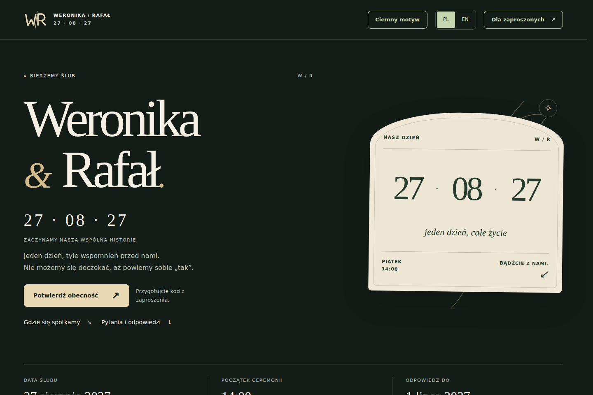

<div align="center">

# Weronika & Rafał
### A wedding website. Thoughtfully built.

An elegant invitation on the outside.<br>
Private RSVPs, useful guest tools and shared memories on the inside.

[](https://github.com/Rafalbanas/weronikarafal/actions/workflows/ci-cd.yml)
[](LICENSE)


**[View the public website](https://weronikarafal.com)** ·
**[Get started](#quick-start)** ·
**[Contribute](CONTRIBUTING.md)** ·
**[Security](SECURITY.md)**



[View the mobile layout →](docs/images/wedding-mobile.png)

</div>

**Built for a real celebration. Open for your next idea.**
This is a self-hosted wedding website built with **Flask, SQLite and vanilla
JavaScript**. No frontend build pipeline, no external font service, no account
required on a wedding platform. You own the deployment and the data.

🇵🇱 **Po polsku:** strona weselna z prywatnym RSVP, panelem organizatorów
i wspólnym albumem. [Dokumentacja aplikacji →](docs/application.md)

## A little beauty. A lot of useful details.

| For your guests | For the organisers |
| --- | --- |
| A responsive invitation, countdown and ceremony calendar download | A separate dashboard for invitations and RSVPs |
| Invitation-code sign-in — no public registration | Household invitations, partners and children |
| RSVP with dietary preferences, accommodation needs and a note | Edit names without invalidating an invitation code |
| Private reception details, schedule and wedding-party contacts | Rotate/revoke codes and manage attendance |
| A shared photo/video album with filters, previews and ZIP download | Local RSVP export, backup commands and media moderation |
| Polish/English, light/dark themes and keyboard-friendly controls | Server-side sessions, CSRF protection and request limits |

The essentials work without JavaScript. JavaScript adds the countdown, theme
switching, upload progress, photo previews and two small feline surprises.
Reduced-motion preferences are respected.

### Privacy, with clear boundaries

- The public page shows the date and ceremony information, not the reception,
  contact list or guest records.
- Signed-in guests can see other invitations' adult names and attendance status.
  Detailed RSVP answers are visible only to their author and the organisers.
- **All signed-in guests can view and download the shared album.**
  Guests can delete their own uploads; organisers can delete any upload.
- Invitation secrets are hashed; private data and uploads stay outside Git
  and the public asset directory.

This is access control, **not end-to-end encryption**. Keep server backups private,
agree on a retention policy and read the [security model](docs/security.md).

## Quick start

Use **Python 3.12**, `venv`, pip and OpenSSL. The media library also needs the
system `file` command/libmagic. **Node.js is needed for tests**, not for serving
the application.

```sh
git clone https://github.com/Rafalbanas/weronikarafal.git
cd weronikarafal
python3 -m venv .venv
.venv/bin/pip install -r requirements.txt

umask 077
export WEDDING_DATA_DIR="$HOME/.local/share/wedding-dev"
mkdir -p "$WEDDING_DATA_DIR"
export WEDDING_SECRET_KEY="$(.venv/bin/python -c 'import secrets; print(secrets.token_urlsafe(48))')"
.venv/bin/python manage.py invite 'Test guest'
```

Keep the displayed invitation code — it is shown once. Use synthetic names
while developing. The development secret above lasts for this shell; production
needs a persistent secret, not a new key on every restart.

**HTTPS is required even locally** because session cookies are `Secure`.
Create a short-lived local certificate and start a loopback-only preview:

```sh
openssl req -x509 -newkey rsa:2048 -nodes -days 7 \
  -keyout "$WEDDING_DATA_DIR/localhost.key" \
  -out "$WEDDING_DATA_DIR/localhost.crt" \
  -subj '/CN=localhost' \
  -addext 'subjectAltName=DNS:localhost,IP:127.0.0.1'

.venv/bin/python -m flask --app 'app:create_app()' run \
  --host 127.0.0.1 --port 8443 \
  --cert "$WEDDING_DATA_DIR/localhost.crt" \
  --key "$WEDDING_DATA_DIR/localhost.key"
```

Open **https://localhost:8443**, accept the warning for your own local
self-signed certificate, then use the invitation code. Do not disable secure
cookies or expose this development server publicly.

To create an organiser account, run `.venv/bin/python manage.py admin your-login`;
the password is entered through a hidden prompt. For production, read the
[deployment guide](deploy/README.md) before changing server configuration.

## Make it yours

Fork it, adapt it, celebrate with it. There is no licence subscription;
hosting and maintenance are your responsibility.

This repository is a **specific wedding site, not a configurable website builder**:

1. Update names, copy, event date and RSVP deadline in `index.html`,
   `templates/` and `wedding/__init__.py`.
2. Keep the calendar constants in `wedding/calendar.py` consistent with the
   countdown, ceremony time and timezone.
3. Replace the domain in SEO metadata, trusted hosts, deployment configuration
   and documentation. Adapt the SVG monogram/favicon and CSS palette.
4. Copy `deploy/details.example.json` **outside the repository**, edit it and
   run `manage.py set-details /private/path/details.json`.
   Only its `ceremony` section is public.
5. Review and adapt tests before deploying your version.

The table-plan page is currently a placeholder, not a seating-plan editor.
There is no built-in email delivery service. Media playback depends on browser
codecs, and file recognition depends on the system libmagic database.

## Under the hood

```text
index.html + templates/   Server-rendered Jinja views
assets/                  Local CSS, JavaScript and SVG
app.py                   Flask routes and access control
wedding/                 SQLite storage, translations and ICS
tests/ + scripts/        Regression tests and optional browser audits
deploy/                  Packaging, server setup and backup tooling
```

```sh
.venv/bin/python -m unittest discover -s tests -v
.venv/bin/python scripts/check_site.py
.venv/bin/python -m compileall -q app.py manage.py wedding scripts deploy tests
bash -n deploy/ssh-command.sh
```

CI checks pull requests. Dependabot proposes weekly Python and GitHub Actions
updates; **there is no automatic merge**. A configured deployment workflow runs
after successful tests on `main`. Dependency changes require a separate server
update — see [automation and bot behaviour](docs/automation.md).

## Explore further

- [Application guide · PL](docs/application.md) — RSVP, media, languages and settings
- [Design notes and checks · PL](docs/ui-ux.md) — inspiration, decisions and validation
- [Independent audit · PL](docs/audit.md) — findings, fixes and release checks
- [Production deployment · PL](deploy/README.md) — setup, migration and rollback
- [Security model · PL](docs/security.md) — access boundaries and data handling
- [Contributing](CONTRIBUTING.md) · [Report a vulnerability](SECURITY.md)
- [GitHub automation & suggested About/topics · PL](docs/automation.md)

## Use it. Improve it. Pass it on.

The code is released under the **[MIT License](LICENSE)**: use, modify and
redistribute it, including commercially, while retaining the copyright and
licence notice. The software comes without warranty.

The licence does **not** grant rights to guests' personal data, private photos
or other third-party material. Replace the couple's identity with your own
when reusing the project; dependency licences still apply.

If this project gives you a useful starting point, **a ⭐ is appreciated**.
Found a rough edge or made a thoughtful improvement? We'd love a
[focused pull request](CONTRIBUTING.md).
